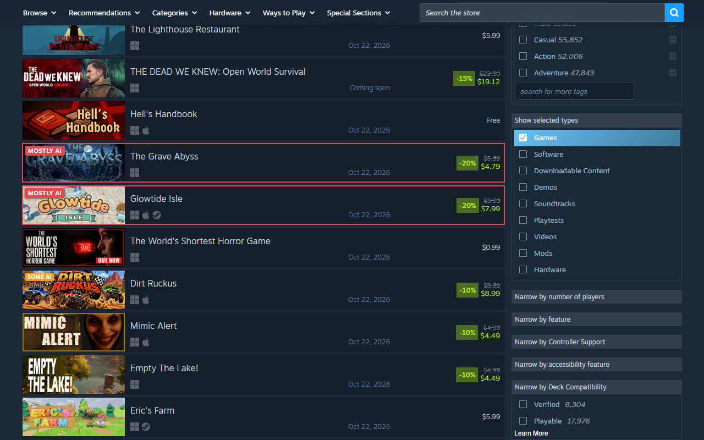

# Remove AI Slop from Steam

Since January 2024, Steam has asked developers to fill in an "AI Generated Content Disclosure". This extension reads that text for every game on a store page and rates it:

| Level               | Means                                                                                   | Disclosure looks like                               |
| ------------------- | --------------------------------------------------------------------------------------- | --------------------------------------------------- |
| Mostly AI-generated | AI made most of the art/sound/writing. Or the game makes content with AI while you play | "All images in the game were generated using AI"    |
| Some AI content     | Some AI-made things in the game                                                         | "Some textures and sound effects were made with AI" |
| AI tools only       | Code help/translation/store page art                                                    | "AI was used only for the logo"                     |

You can customize what to catch + what happens to those games (hide/blur/label). By default it hides "mostly AI-generated" games and puts a small "Some AI" tag on the level below.



## Install

- Chrome/Edge/Brave/Opera: Chrome Web Store (TODO: you forgor to add the link)
- Firefox and Firefox for Android: addons.mozilla.org (TODO: you forgor to add the link)
- Steam desktop client: install [Millennium](https://steambrew.app) with the [Extendium](https://github.com/BossSloth/Extendium) plugin. Then add the extension from the Chrome Web Store through Extendium.
- From source: see [Build](#build)

## Where it works

All of store.steampowered.com. Games on your wishlist/cart are labeled, not hidden.

## What it can't do

- Disclosures are self-reported. A 🐀 developer who keeps quiet about AI will not be filtered.
- The "level" is this extension's reading of free text. Keyword rules cover English + some Chinese/Japanese/Korean/Russian. Some calls WILL be wrong. Hover a label to read what the developer actually wrote. You're also free to contribute to improve accuracy.
- steamcommunity.com is not touched.

## How it works

Store pages list games as links/capsule images. The extension collects their app IDs and pokes Steam for each disclosure through the store's API (`IStoreBrowseService/GetItems`. 100 games per request with no key). Answers are cached for 3 days (no disclosure) or 14 days (disclosure).

The rating/classification rules can be found in [src/lib/classify.js](src/lib/classify.js). They were tuned on 1,290 disclosures pulled from Steam on 2026-10-22 (random app IDs between 2.5M and 4.3M).

## Privacy

Nothing is collected. The only requests go to Steam's API. Details in [PRIVACY.md](PRIVACY.md).

## Build

Node 22.2 or newer. No NPM packages.

```
npm test
npm run build
```

`dist/chrome` and `dist/firefox` are unpacked builds. The zips are for the stores (the Chrome one also works for Edge Add-ons + Opera).

To try a build:

- Chrome: `chrome://extensions` > Developer mode > Load unpacked > `dist/chrome`
- Firefox: `about:debugging#/runtime/this-firefox` > Load Temporary Add-on > `dist/firefox/manifest.json`

## Similar projects

- [BeGe-01/nextfest-hide-ai](https://github.com/BeGe-01/nextfest-hide-ai): userscript for the Next Fest page
- [seeeeew/aiwarningforsteam](https://github.com/seeeeew/aiwarningforsteam): disclosure popup on game pages, blur on search
- SteamDB search leaves out disclosed games with `&tagid=-1368160` in the URL

## License

[MIT](LICENSE)
